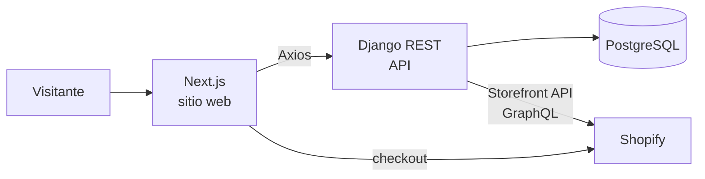

# Bioproductos DK

Prototipo de una plataforma web para **BioProductos DK**, empresa chilena de productos de limpieza y cuidado personal hechos a partir de la revalorización de residuos orgánicos.

El prototipo propone una mejora del sitio actual ([bioproductosdk.com](https://bioproductosdk.com/)). Usa una arquitectura híbrida: **Next.js** para el sitio, **Django REST + PostgreSQL** para los formularios y la conexión comercial, y **Shopify** para el catálogo, el carrito y el pago. Así se aprovecha la suscripción de Shopify que la tienda ya tiene.

> **Estado:** prototipo completo y publicado. Funciona de punta a punta: formularios guardados en la base de datos, catálogo real desde Shopify, carrito, checkout y pedidos registrados.

## Sitio publicado

| Servicio | Dirección |
|---|---|
| Sitio web | https://bioproductos-dk-web-wccb.onrender.com |
| API (Django REST) | https://bioproductos-dk-api.onrender.com |
| Panel de administración | https://bioproductos-dk-api.onrender.com/admin/ |

El plan gratuito de Render "duerme" los servicios sin uso: la primera visita puede tardar alrededor de un minuto. La tienda de Shopify es de desarrollo, así que el checkout pide una contraseña y los pagos son de prueba.

## Qué incluye el prototipo

- **Sitio editorial** con el diseño de Byron: inicio, Nosotras, Bio Investigación, Bio Impacto, Empresas, Donaciones, Dónde comprar, Contacto e Información legal. Incluye modo claro y oscuro, y está adaptado a celular, tablet y escritorio.
- **Formularios conectados a Django**, guardados en PostgreSQL y visibles en el panel de administración:
  - Contacto (`/contacto`)
  - Donaciones de materiales (`/donaciones`)
  - Solicitudes de empresas (`/empresas`)
- **Tienda conectada a Shopify** (`/productos`):
  - Catálogo con precios en pesos chilenos (CLP), fotos y variedades (tipo de cabello, aromas de sales).
  - Carrito con hasta 10 unidades por producto; la primera variedad viene elegida.
  - Checkout en el sitio seguro de Shopify, en español, con despacho a Chile.
  - Tras la compra, el carrito se vacía solo al volver al sitio.
  - Los productos sin stock en Shopify aparecen como **"Próximamente"** y no se pueden agregar. Se habilitan solos al reponer el inventario.
- **Respaldo automático:** si la API no responde, `/productos` muestra una simulación local del catálogo en vez de romperse.

## Arquitectura



- El sitio **nunca** habla directo con Shopify para leer el catálogo: lo pide a Django. Así los tokens de Shopify quedan solo en el servidor.
- El pago ocurre en el checkout de Shopify. Django crea el carrito (`cartCreate`) y entrega la URL de pago.

## Tecnologías utilizadas

### Frontend
| Tecnología | Uso |
|---|---|
| **Next.js 15** (App Router) + **React 19** | Sitio web |
| **TypeScript** | Tipado del código |
| **Tailwind CSS** + CSS Modules | Estilos |
| **Axios** | Llamadas a la API de Django |
| **Zod** | Validación de formularios en el navegador |
| **SweetAlert2** | Mensajes de confirmación y error |
| **sharp** | Fotos del inicio convertidas a WebP |
| npm workspaces | Organización del proyecto (`frontend/`) |

### Backend
| Tecnología | Uso |
|---|---|
| **Python 3.12** + **Django 6.1** | Servidor y panel de administración |
| **Django REST Framework** | API de formularios y tienda, con límites anti-spam |
| **django-cors-headers** | Solo el sitio propio puede llamar a la API |
| **requests** | Conexión con la Storefront API de Shopify |
| **python-dotenv** | Variables de entorno en local (`.env`) |
| **gunicorn**, **whitenoise**, **dj-database-url** | Producción en Render |

### Datos, comercio y despliegue
| Tecnología | Uso |
|---|---|
| **PostgreSQL** | Base de datos (local: v18; producción: Render) |
| **Shopify** (Headless + Storefront API, GraphQL `2026-10`) | Catálogo, inventario, carrito, checkout y pedidos |
| **Render** (Blueprint `render.yaml`) | Hosting del sitio, la API y la base de datos |
| **Git + GitHub** | Control de versiones |

### Herramientas de desarrollo
| Herramienta | Uso |
|---|---|
| Visual Studio Code + Git Bash | Editor y terminal |
| Node.js test runner | Pruebas unitarias (`npm test`) |
| Playwright + axe | Pruebas de extremo a extremo y accesibilidad (`npm run test:e2e`) |
| ESLint + Prettier | Calidad y formato del código |

### Asistente de inteligencia artificial
El proyecto se desarrolló con apoyo de **[Claude Code](https://claude.com/claude-code)**, el asistente de programación de **Anthropic**, usando el modelo **Claude Opus 5.5**.

- **Backend:** el equipo lo escribió paso a paso, y Claude Code revisó cada etapa y ayudó a corregir errores.
- **Frontend:** Claude Code adaptó el diseño de Byron y lo conectó a la API.
- **Despliegue y Shopify:** Claude Code preparó la configuración de Render y guió la configuración de Shopify.
- **Pruebas:** después de cada cambio, Claude Code corrió las pruebas y revisó el resultado en el navegador.
- **Decisiones y commits:** el equipo revisó cada cambio, tomó las decisiones del proyecto e hizo todos los commits.

## Estructura del repositorio

```
bioproductosdk/
├── backend/                 API Django
│   ├── biobackend/          configuración (settings, urls)
│   ├── contacto/            formulario de contacto
│   ├── colaboraciones/      donaciones de materiales
│   ├── empresas/            solicitudes de empresas
│   ├── tienda/              conexión con Shopify
│   ├── build.sh             pasos de build en Render
│   └── requirements.txt
├── frontend/                sitio Next.js (monorepo npm)
│   ├── apps/storefront/     la aplicación web
│   ├── tests/               pruebas unitarias y e2e
│   └── scripts/             utilidades (fotos, verificación)
├── shopify/                 CSV de productos para importar en Shopify
└── render.yaml              Blueprint de Render (base de datos + API + sitio)
```

## API

| Método | Ruta | Descripción |
|---|---|---|
| POST | `/api/contacto/consultas/` | Guarda una consulta de contacto |
| POST | `/api/colaboraciones/` | Guarda una donación de materiales |
| POST | `/api/empresas/` | Guarda una solicitud de empresa |
| GET | `/api/tienda/productos/` | Catálogo de Shopify en CLP (caché de 60 s) |
| POST | `/api/tienda/checkout/` | Crea el carrito en Shopify y devuelve la URL de pago |
| GET | `/api/tienda/carrito/?id=` | Indica si un carrito ya se convirtió en pedido |

Los formularios tienen un límite de 5 envíos por minuto, el checkout de 10 y la consulta del carrito de 30.

## Cómo correrlo en local

**Requisitos:** Python 3.12, Node.js 22 o superior y PostgreSQL.

### 1. Backend (puerto 8001)
```bash
python -m venv venv
source venv/Scripts/activate        # Windows (Git Bash)
pip install -r backend/requirements.txt
cp backend/.env.example backend/.env # y completar los valores
cd backend
python manage.py migrate
python manage.py createsuperuser
python manage.py runserver 8001
```

### 2. Frontend (puerto 8000)
```bash
cd frontend
npm ci
cd apps/storefront
npx next dev -p 8000 -H 127.0.0.1
```

Abrir http://127.0.0.1:8000. En Windows, el script `npm run dev` no funciona: usar el comando `npx` de arriba.

### Variables de entorno
Ver [`backend/.env.example`](backend/.env.example). Los tokens de Shopify y las contraseñas **nunca** se suben a GitHub: se piden al equipo por un canal privado. Sin los tokens, `/productos` funciona con la simulación local.

## Despliegue en Render

`render.yaml` crea tres servicios: la base de datos `bioproductos-dk-db`, la API `bioproductos-dk-api` y el sitio `bioproductos-dk-web`.

1. En Render, ir a **New → Blueprint** y elegir este repositorio, rama `main`.
2. Completar los valores secretos que pide el panel: el token privado de Shopify y el usuario, correo y contraseña del administrador de Django.
3. Cada `git push` a `main` vuelve a desplegar los servicios solos.
4. Si se cambia `render.yaml`, hay que hacer **Manual sync** en la página del Blueprint.

**Notas del plan gratuito:**
- La base de datos gratuita de Render vence a los 30 días.
- Render agregó `-wccb` a la dirección del sitio porque el nombre ya estaba ocupado. Esa dirección real está configurada en `CORS_ALLOWED_ORIGINS` y `NEXT_PUBLIC_BASE_URL`.

## Shopify

- **Tienda de desarrollo:** `bioproductos-dk-prototipo.myshopify.com`, con mercado Chile en CLP, despacho a $3.000 y pago manual "Depósito bancario" para pruebas.
- **Canal Headless:** la API usa la Storefront API con un token privado.
- **Productos:** los productos se importaron desde [`shopify/productos-prototipo.csv`](shopify/productos-prototipo.csv). Los **precios son de ejemplo** hasta que la tienda entregue los reales.
- **Inventario:** con seguimiento de inventario y stock en 0, el producto aparece como "Próximamente" en el sitio.

## Pruebas

```bash
cd frontend
npm test            # 47 pruebas unitarias
npm run test:e2e    # Playwright (requiere instalar los navegadores)
```

## Próximos pasos

- Cargar los precios reales y las fotos de jabón y acondicionador.
- Pasar de la tienda de desarrollo a la suscripción de Shopify de la tienda, con un medio de pago real.
- Conectar un dominio propio, por ejemplo un subdominio de `bioproductosdk.com`.
- Envío de correos al recibir formularios. Hoy se guardan en el panel de administración.
- Autenticación con JWT para un panel propio. Está en el diseño de la arquitectura, pero no en este prototipo.
- Actualizar las pruebas e2e del inicio a la colección actual de 5 tarjetas.

## Equipo

- **Samuel** ([@SamuelitoCe](https://github.com/SamuelitoCe)): backend Django, integración con Shopify y despliegue.
- **Renato Miranda** ([@Remi0417](https://github.com/Remi0417)): repositorio y coordinación.
- **Byron**: diseño del sitio web (frontend).

Con el apoyo de **Claude Code** (Anthropic, modelo **Claude Opus 5.5**) como asistente de programación.
